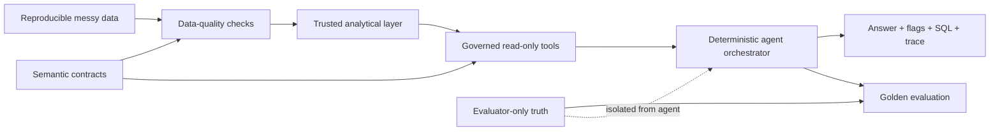

# Auditable Ecommerce Analytics Agent

**A reliability-first analytics agent that answers governed metric questions—and refuses to answer when the data is not trustworthy.**

Most analytics-agent demos begin with a clean table and end with generated SQL. This project models the harder, more realistic workflow: define business meaning, detect and repair data issues, constrain how metrics can be queried, expose the evidence behind every answer, and abstain when a valid answer is impossible.

> Portfolio status: deterministic MVP on a reproducible synthetic ecommerce environment. It demonstrates product and system design; it is not a production-accuracy claim.

## Why this project is different

| Design choice | What it proves |
|---|---|
| **Auditable by default** | Every answer includes the metric definition, applied quality and policy flags, sources, parameterized SQL, parameters, and an execution trace. |
| **Semantics before automation** | Grain, keys, joins, identity rules, conversion denominators, refund timing, fraud treatment, and data availability are explicit, versioned contracts—not prompt assumptions. |
| **Built for messy reality** | The synthetic environment contains bot traffic, duplicate SDK events, session inflation, tracking outages, schema migration, fraud signals, and legitimate business changes that must not be “cleaned away.” |
| **Reliability over forced answers** | The agent distinguishes cleaned results, investigation context, and unavailable metrics. It abstains instead of returning zero, extrapolating, or inventing missing events. |
| **Reusable, not hard-coded to one question** | The same contract → cleanup → trusted layer → governed tool → agent → evaluation workflow can be extended to new metrics and datasets. |
| **Evaluation-driven** | Deterministic tests and evaluator-only golden cases protect both numerical correctness and business-policy behavior. |

## Verified proof points

| Evidence | Result |
|---|---:|
| Unit and regression tests | **37/37 passed** |
| Golden evaluation scenarios | **8/8 passed** |
| Injected data incidents | **8** |
| Legitimate-change negative controls | **4** |
| Governed business metrics | **6** |
| Suspected-bot Visits excluded from Jan 10–12 Web headline | **375** |

The dataset is generated from seed `42` and covers 120 days, 10,000 users, 71,279 raw sessions, 320,986 raw events, and 5,593 orders. Generated data and databases are intentionally excluded from Git so the public repository stays lightweight and reproducible.

### Dataset access

For immediate exploration, download the versioned synthetic dataset from the [latest GitHub Release](https://github.com/tanmiemie/auditable-ecommerce-analytics-agent/releases/latest). For full reproducibility, regenerate the same data locally with `python3 generator/generate_data.py`. This keeps large generated files out of Git history while supporting collaborators who want to begin analysis without waiting for generation.

See [Dataset guide](docs/DATASET.md) for contents, provenance, and usage boundaries.

## Example behavior

**Question:** `Why did Web visits increase in January?`

The agent returns 5,423 cleaned Visits, discloses that 375 suspected-automation Visits from Jan 10–12 were blocked from the headline, and surfaces a Jan 20–26 campaign as context without claiming unproven causality.

**Question:** `Is iOS checkout tracking available from 2026-03-15 to 2026-03-18?`

The agent returns `unavailable`. Server-side orders continued while iOS 6.1.0 checkout events were missing, but it does not use orders to fabricate missing client events.

**Question:** `As of 2026-05-11, how did March net revenue compare with February?`

The agent applies refund requests at request time, checks the 30-day refund-maturity window against the explicit as-of date, and labels whether each revenue cohort is final.

## Architecture



The current orchestrator is deliberately deterministic and scoped; it is not presented as general natural-language intelligence. This makes policy behavior inspectable and provides a safe baseline for deciding where an LLM would add value.

## Product decisions encoded in the semantic layer

- Visits use a canonical 30-minute inactivity rule.
- Visitor conversion and Visit conversion remain separate metrics.
- App identity may stitch pre-login behavior retroactively; Web identity respects `effective_from`.
- Confirmed fraud is excluded. Suspected or unconfirmed fraud remains in commercial metrics and receives a Risk-review flag.
- Employee orders remain included and are flagged.
- Refunds reduce Net Revenue when requested.
- Net Revenue becomes final only after the 30-day refund window closes.
- Missing checkout events make checkout-dependent metrics unavailable; server orders cannot substitute for missing client telemetry.

See [the semantic-layer specification](docs/semantic_layer.md) and [metric contracts](config/metrics.yml).

## Run locally

Requirements: Python 3.10+ and SQLite. The project uses only the Python standard library.

```bash
git clone https://github.com/tanmiemie/auditable-ecommerce-analytics-agent.git
cd auditable-ecommerce-analytics-agent

# Generate the fixed synthetic environment
python3 generator/generate_data.py

# Validate injected scenarios and build the trusted layer
python3 validation/validate_generated_data.py
PYTHONPATH=src python3 -m analytics_agent.trusted_layer

# Run the demo, tests, and golden evaluation
PYTHONPATH=src python3 scripts/run_demo.py
PYTHONPATH=src python3 -m unittest discover -s tests -v
PYTHONPATH=src python3 evals/run_evals.py
```

Run one question:

```bash
PYTHONPATH=src python3 -m analytics_agent.agent \
  "As of 2026-05-11, how did March net revenue compare with February?"
```

## Answer contract

Every successful metric answer returns:

1. the approved definition and requested scope;
2. a cleaned business headline;
3. data-quality and business-policy flags;
4. bounded comparison or investigation evidence;
5. data status, sources, limitations, and unavailable states;
6. exact parameterized SQL and parameters;
7. an inspectable execution trace.

The agent cannot execute arbitrary SQL, modify source data, confirm suspected fraud, cancel orders, block accounts, or publish experiment conclusions.

## Repository map

| Path | Purpose |
|---|---|
| `config/` | Semantic, metric, and data-quality contracts |
| `generator/` | Reproducible synthetic environment and evaluator reference builder |
| `scripts/package_dataset.py` | Builds the versioned collaborator download bundle |
| `src/analytics_agent/trusted_layer.py` | Deterministic raw-to-trusted transformation |
| `src/analytics_agent/governed_tools.py` | Whitelisted, parameterized metric and evidence tools |
| `src/analytics_agent/agent.py` | Scoped deterministic orchestration and response contract |
| `tests/` | Unit and policy regression tests |
| `evals/` | Golden cases and deterministic evaluator runner |
| `.agents/skills/data-cleanup/` | Reusable cleanup workflow and check registry |
| `docs/PORTFOLIO_CASE_STUDY.md` | Recruiter-friendly case study |
| `docs/DECISION_LOG.md` | Key product decisions, evidence, and validation trace |

## Known limitations

- The parser supports a bounded question set rather than open-ended natural language.
- Fraud labels do not have effective timestamps, so historical exclusions use the latest known state.
- Inventory history and referral/navigation evidence are not available.
- The golden set verifies known synthetic behaviors; it does not measure production generalization.
- Authentication, warehouse integration, access control, observability, concurrency, and SLAs are out of scope for this MVP.

## Documentation

- [Portfolio case study](docs/PORTFOLIO_CASE_STUDY.md)
- [Live demo script](docs/DEMO.md)
- [Dataset guide](docs/DATASET.md)
- [Semantic layer](docs/semantic_layer.md)
- [Data-cleanup checklist](docs/DATA_CLEANUP_CHECKLIST.md)
- [Governed analytics tools](docs/GOVERNED_ANALYTICS_TOOLS.md)
- [Agent workflow](docs/SINGLE_AGENT_WORKFLOW.md)
- [Evaluation design](docs/EVALUATION_SUITE.md)
- [Architecture and extension path](docs/ARCHITECTURE.md)

## Responsible-use boundary

All data in this repository is synthetic. Fraud-related signals are treated as review candidates, not proof. The system is designed to support analyst judgment, not to take customer-impacting actions autonomously.
